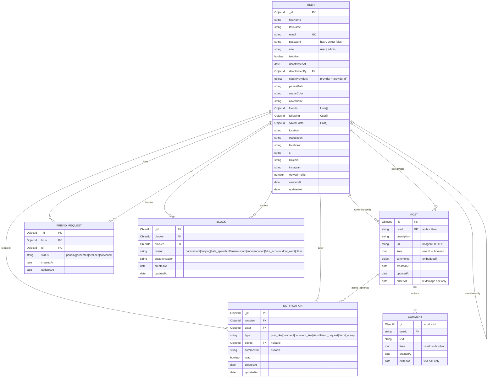

# Xivi - Entity relationship diagram

Data model derived from the Mongoose schemas in `backend/models/`.

MongoDB stores some relationships as arrays or embedded documents (not separate SQL-style tables).

← Back to [README](../README.md) · [Schema](./SCHEMA.md) · [Features](./FEATURES.md) · [API](./API.md)

---

## Diagram

---

## Collections

| Collection       | Model file                        | Notes                                          |
| ---------------- | --------------------------------- | ---------------------------------------------- |
| `users`          | `backend/models/User.js`          | Auth, profile, friends, following, saved posts |
| `posts`          | `backend/models/Post.js`          | Feed content; comments embedded                |
| `friendrequests` | `backend/models/FriendRequest.js` | Pending/accepted/declined/cancelled requests   |
| `blocks`         | `backend/models/Block.js`         | Blocker → blocked, with private reason         |
| `notifications`  | `backend/models/Notification.js`  | In-app bell notifications                      |

`Comment` is **not** a separate collection - it is an embedded subdocument array on `Post`.

---

## Relationship notes

| Relationship         | How it is stored                                                               |
| -------------------- | ------------------------------------------------------------------------------ |
| Friends              | Both users’ `friends` arrays (mutual)                                          |
| Following            | Follower’s `following` array only (one-way)                                    |
| Post / comment likes | `Map` keyed by user id on the post or comment                                  |
| Saved posts          | `User.savedPosts` → `Post`                                                     |
| Friend request       | `FriendRequest.from` / `.to` → `User` (unique pending pair index)              |
| Block                | `Block.blocker` / `.blocked` → `User` (unique pair; API hides both directions) |
| Notification         | `recipient` + `actor` → `User`; optional `postId` → `Post`                     |
| Admin deactivate     | `User.deactivatedBy` → `User`                                                  |

---

## Indexes (high level)

- **User:** unique `email`
- **FriendRequest:** unique pending `(from, to)`; indexes on `(to, status, createdAt)` and `(from, status, createdAt)`
- **Block:** unique `(blocker, blocked)`; indexes on `(blocker, createdAt)` and `blocked`
- **Notification:** `recipient`; `(recipient, createdAt)`
